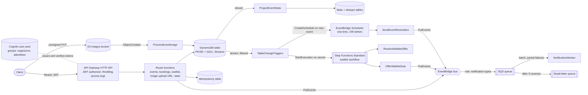

# Bookings API

A serverless event-booking API on AWS. Organizers publish events with a fixed number of seats, upload an event image and read live booking stats. Attendees book and cancel seats, and join a waitlist when an event is sold out. Bookings, cancellations, waitlist offers and day-before reminders all become notifications through one queue.

Built by Ramiz Raja as a small but complete example of production-style serverless TypeScript:

- API Gateway HTTP API, Lambda (Node.js 24, arm64), DynamoDB single-table design with Streams, Cognito, S3, Step Functions, EventBridge (bus and Scheduler) and SQS, all defined in CDK.
- Event-driven features: S3 upload events, a Step Functions waitlist started from DynamoDB Streams, one-time EventBridge Scheduler reminders and a stream-fed stats projection.
- Seats can't be oversold: one DynamoDB transaction with conditions, proved by a concurrency test against DynamoDB Local.
- Idempotent bookings through the `Idempotency-Key` header (Powertools for AWS Lambda).
- Hexagonal layers with constructor injection, zod at the boundary, typed errors mapped to RFC 9457 problem responses.
- Least-privilege IAM, cdk-nag AwsSolutions checks on every synth, and tests at three levels with a coverage gate in CI.

The API contract is in [openapi.yaml](openapi.yaml).

## Architecture



All 17 functions use Powertools Logger (structured JSON), Tracer (X-Ray) and Metrics (CloudWatch EMF).

### Code layout

```
src/
  shared/           actor and roles, typed errors, HTTP edge (problem details, request parsing),
                    DynamoDB client, keys and cursors, observability
  features/
    events/         domain/ application/ adapters/ http/
    events/         + s3/ (image upload events)
    bookings/       domain/ application/ adapters/ http/
    waitlist/       domain/ application/ adapters/ http/ stream/ workflow/ (Step Functions tasks)
    reminders/      domain/ application/ adapters/ stream/ scheduler/
    reporting/      domain/ application/ adapters/ http/ stream/ (stats projection)
    notifications/  domain/ application/ adapters/ sqs/
  functions/        one thin Lambda entry per route, plus composition.ts (the composition root)
infra/
  bin/app.ts        CDK app; registers cdk-nag AwsSolutions
  lib/              BookingsStack and constructs: Data, Auth, Messaging, Api, AppFunction,
                    Images, WaitlistWorkflow, Reminders
tests/
  unit/             use cases and handlers against in-memory fakes
  integration/      DynamoDB adapters and Powertools idempotency against DynamoDB Local
  infra/            CDK template assertions, a snapshot and a cdk-nag check
```

Dependencies point inwards: `domain` has no AWS imports. `application` (use cases) depends on ports such as `EventRepository`, `BookingRepository`, `BookingEventPublisher`, `Clock` and `Telemetry`. `adapters` implement those ports with the AWS SDK. `http` parses and maps. Each file in `functions/` builds its graph once per cold start and exports `handler`. Stream, S3, Scheduler and Step Functions entry points live in the feature's `stream/`, `s3/`, `scheduler/` or `workflow/` folder, the same way HTTP lives in `http/`.

## Request flow: booking seats

`POST /events/{eventId}/bookings` with `Idempotency-Key: <uuid>` and `{ "seats": 2 }`:

1. API Gateway checks the Cognito access token (signature, issuer, audience, expiry). An invalid token gets a 401 and never reaches Lambda.
2. The handler reads the caller from the verified claims (`sub`, `cognito:groups`). Then it validates the path, the header and the body with zod. Bad input gets a 400 with field errors.
3. Powertools idempotency looks up `[userId, idempotencyKey]` in the idempotency table:
   - A completed record returns the stored booking (201), without booking again.
   - A record that is still in progress gets a 409 `REQUEST_IN_PROGRESS`.
   - The same key sent with a different body gets a 422 `IDEMPOTENCY_KEY_REUSED`.
4. `BookSeats` checks the role (`attendees`), loads the event and applies the domain rules: 1 to 10 seats, the event hasn't started, enough seats left. That last check is only a fast path for a clear error message.
5. The repository writes one `TransactWriteItems` with three parts:
   - Decrement `seatsRemaining` on the event, conditioned on `seatsRemaining >= :seats`.
   - Put the booking, conditioned on `attribute_not_exists`.
   - Put an attendee marker (`EVENT#id / ATTENDEE#userId`), conditioned on `attribute_not_exists`. This allows one active booking per user per event.

   A failed condition maps to `SOLD_OUT`, `ALREADY_BOOKED` or `EVENT_NOT_FOUND`. A `TransactionConflict` is retried with jittered backoff, then surfaced as 409 `CONCURRENT_UPDATE`.

6. A `BookingConfirmed` event goes to EventBridge. A rule sends it to SQS. The worker processes batches and reports only the failed messages back (`ReportBatchItemFailures`). After 3 receives, a message moves to the DLQ.
7. The response is 201 with the booking. Powertools stores it under the key for 24 hours.

Cancelling runs the reverse transaction: it returns the seats, marks the booking `CANCELLED` and deletes the attendee marker. Someone else's booking returns 404, so the API doesn't reveal which booking IDs exist.

## Event-driven flows

### Event images

1. The organizer calls `POST /events/{eventId}/image-upload-url` with the content type and size. The function checks ownership and limits (JPEG, PNG or WebP, at most 5 MiB) and returns a presigned PUT URL valid for 5 minutes. The signature covers the content type and length, so the client can't swap them.
2. The client uploads straight to the private bucket, so no image bytes pass through Lambda or API Gateway.
3. The `ObjectCreated` notification invokes `ProcessEventImage`. It reads only the first bytes with a ranged GET and checks the magic bytes against the declared type. A match attaches `image` to the event; anything else is deleted.

### Waitlist

1. When an event is sold out, `POST /events/{eventId}/waitlist` adds the attendee in join order. It answers 409 if seats are free, or if the caller is already booked or waiting.
2. A cancellation changes the booking item from `CONFIRMED` to `CANCELLED`. A DynamoDB Streams event source mapping with a filter passes only that change to `TableChangeTriggers`, which starts one execution of the waitlist state machine with the number of freed seats.
3. The state machine offers each seat in turn (a Map with concurrency 1). `OfferWaitlistSeat` marks the next waiting person `OFFERED` and publishes `WaitlistSeatOffered`. A Wait state holds the offer for 15 minutes. `ResolveWaitlistOffer` then checks it: accepted ends the branch, expired loops back and offers the seat to the next person, and an empty waitlist ends it.
4. The attendee calls `POST /events/{eventId}/waitlist/accept` before the offer expires. One transaction books one seat and marks the entry `ACCEPTED`.

### Reminders

1. A new event item (`INSERT` on `META`) reaches `TableChangeTriggers` through the same filtered stream.
2. If the event starts more than 24 hours from now, it creates a one-time EventBridge Scheduler schedule `reminder-<eventId>` with an `at()` expression, in a dedicated schedule group, with `ActionAfterCompletion: DELETE` so the schedule removes itself after running. A retried stream batch gets `ConflictException`, which counts as done.
3. At that time Scheduler invokes `SendEventReminders` (failed invocations go to a DLQ). It reads the confirmed bookings and publishes one `EventReminder` per attendee to the bus, so reminders reuse the notification queue, retries and DLQ.

### Organizer stats

`ProjectEventStats` reads every stream record and updates per-event counters: confirmed and cancelled bookings, seats booked, and waitlist joins, offers, acceptances and expiries. Each update is a transaction that also writes the stream record's `eventID` into a dedupe table with a 2-day TTL, so a replayed batch never counts twice. `GET /events/{eventId}/stats` returns the counters to the event's organizer.

## Decisions

| Decision                                      | Why                                                                                                                                                                                                                                                                                                                 | Reference                                                                                                                                                                                                                                     |
| --------------------------------------------- | ------------------------------------------------------------------------------------------------------------------------------------------------------------------------------------------------------------------------------------------------------------------------------------------------------------------- | --------------------------------------------------------------------------------------------------------------------------------------------------------------------------------------------------------------------------------------------- |
| HTTP API, not REST API                        | Cheaper and faster. It has a built-in JWT authorizer for Cognito, and this API needs nothing that only REST APIs offer.                                                                                                                                                                                             | [Choose between REST and HTTP APIs](https://docs.aws.amazon.com/apigateway/latest/developerguide/http-api-vs-rest.html), [JWT authorizers](https://docs.aws.amazon.com/apigateway/latest/developerguide/http-api-jwt-authorizer.html)         |
| Roles from Cognito groups                     | The groups come through as a verified token claim, so the functions need no extra lookup. Self sign-up is off and an admin assigns groups.                                                                                                                                                                          | [Cognito user pool groups](https://docs.aws.amazon.com/cognito/latest/developerguide/cognito-user-pools-user-groups.html)                                                                                                                     |
| Single DynamoDB table with GSI1               | All access patterns are known, so one table keeps the event, its bookings and its attendee markers in one partition. That partition can then be written atomically. See `src/shared/dynamodb/keys.ts`.                                                                                                              | [Single-table design](https://docs.aws.amazon.com/amazondynamodb/latest/developerguide/data-modeling-foundations.html)                                                                                                                        |
| Conditional transaction for seats             | The condition in DynamoDB is the only thing that prevents overselling. Checking in code first would race.                                                                                                                                                                                                           | [TransactWriteItems](https://docs.aws.amazon.com/amazondynamodb/latest/developerguide/transaction-apis.html), [Condition expressions](https://docs.aws.amazon.com/amazondynamodb/latest/developerguide/Expressions.ConditionExpressions.html) |
| Powertools idempotency, scoped per user       | Retries after a timeout are safe. Putting the user in the key means two users can't collide. Failed calls aren't stored, so a retry after `SOLD_OUT` runs again.                                                                                                                                                    | [Powertools idempotency](https://docs.aws.amazon.com/powertools/typescript/latest/features/idempotency/)                                                                                                                                      |
| EventBridge → SQS → Lambda with a DLQ         | The bus decouples producers from consumers. The queue adds buffering, retries and a DLQ. The queue's visibility timeout is 6x the worker timeout, as AWS recommends.                                                                                                                                                | [SQS as a Lambda event source](https://docs.aws.amazon.com/lambda/latest/dg/with-sqs.html), [Partial batch responses](https://docs.aws.amazon.com/lambda/latest/dg/services-sqs-errorhandling.html)                                           |
| Powertools Logger, Tracer, Metrics            | Structured logs with correlation IDs, X-Ray traces of AWS SDK calls, and business metrics (`BookingConfirmed`, `SeatsBooked`, `BookingRejectedSoldOut`) without custom plumbing.                                                                                                                                    | [Powertools for AWS Lambda (TypeScript)](https://docs.aws.amazon.com/powertools/typescript/latest/)                                                                                                                                           |
| `NodejsFunction`, Node.js 24 on arm64, ESM    | esbuild bundles a small ESM file per function. Graviton costs less per GB-second.                                                                                                                                                                                                                                   | [NodejsFunction](https://docs.aws.amazon.com/cdk/api/v2/docs/aws-cdk-lib.aws_lambda_nodejs-readme.html), [arm64 architecture](https://docs.aws.amazon.com/lambda/latest/dg/foundation-arch.html)                                              |
| One IAM role per function, least privilege    | Each function gets only the DynamoDB actions its code calls, on its own tables, and writes only to its own log group.                                                                                                                                                                                               | [Lambda execution role](https://docs.aws.amazon.com/lambda/latest/dg/lambda-intro-execution-role.html)                                                                                                                                        |
| cdk-nag AwsSolutions on every synth           | Findings fail `cdk synth`. Each accepted finding is acknowledged with a reason in `infra/lib/nag-suppressions.ts`.                                                                                                                                                                                                  | [cdk-nag](https://github.com/cdklabs/cdk-nag)                                                                                                                                                                                                 |
| Step Functions Standard for the waitlist      | An offer waits 15 minutes and may repeat for each person in line. Standard workflows can run up to a year and charge per state transition, not for time spent waiting. Express workflows stop after 5 minutes.                                                                                                      | [Choosing a workflow type](https://docs.aws.amazon.com/step-functions/latest/dg/choosing-workflow-type.html), [Wait state](https://docs.aws.amazon.com/step-functions/latest/dg/state-wait.html)                                              |
| DynamoDB Streams as the trigger, with filters | Waitlist and reminders react to committed data, so the API path stays one write and nothing can start for a change that rolled back. Event filtering means the trigger function is only invoked for the two changes it handles. A shard serves at most two readers, and this design uses both (stats and triggers). | [Streams and Lambda](https://docs.aws.amazon.com/amazondynamodb/latest/developerguide/Streams.Lambda.html), [Event filtering](https://docs.aws.amazon.com/lambda/latest/dg/with-ddb-filtering.html)                                           |
| EventBridge Scheduler one-time schedules      | One `at()` schedule per event fires exactly when needed, with no polling job, and deletes itself after it runs. The role Scheduler assumes can invoke only the reminders function, and trusts only this account.                                                                                                    | [Schedule types](https://docs.aws.amazon.com/scheduler/latest/UserGuide/schedule-types.html#one-time), [Deleting a schedule after completion](https://docs.aws.amazon.com/scheduler/latest/UserGuide/managing-schedule-delete.html)           |
| Presigned S3 PUT for images                   | Large uploads skip API Gateway's payload limit and Lambda time. The bucket stays private, and the magic-byte check runs after upload because a client controls the headers it sends.                                                                                                                                | [Presigned URL uploads](https://docs.aws.amazon.com/AmazonS3/latest/userguide/PresignedUrlUploadObject.html), [S3 event notifications](https://docs.aws.amazon.com/AmazonS3/latest/userguide/EventNotifications.html)                         |
| Stats as a stream projection with dedupe      | Counters are kept off the booking transaction, so reads of stats never contend with bookings. Stream delivery is at least once, so a dedupe record per stream `eventID` makes each update count once.                                                                                                               | [DynamoDB Streams](https://docs.aws.amazon.com/amazondynamodb/latest/developerguide/Streams.html)                                                                                                                                             |
| zod at the edge, typed errors inside          | Handlers turn untrusted input into typed commands. Domain code throws `AppError` subclasses, and only the HTTP edge maps them to status codes. Anything else becomes a generic 500.                                                                                                                                 | [RFC 9457 problem details](https://www.rfc-editor.org/rfc/rfc9457)                                                                                                                                                                            |

## Run and test

Requirements: Node.js 24 (see `.nvmrc`) and Docker for the integration tests.

```sh
npm ci
npm run format:check   # Prettier
npm run lint           # typescript-eslint strict-type-checked
npm run typecheck      # tsc, strict
npm run test:unit
npm run test:integration   # starts amazon/dynamodb-local with Testcontainers and stops it afterwards
npm run test:infra
npm run test:coverage      # all three projects, fails below 90% lines/functions/statements, 85% branches
npm run synth              # bundles every function and runs cdk-nag
```

If you use Colima instead of Docker Desktop, point Testcontainers at its socket first:

```sh
export DOCKER_HOST=unix://$HOME/.colima/default/docker.sock
export TESTCONTAINERS_DOCKER_SOCKET_OVERRIDE=/var/run/docker.sock
```

The concurrency test (`tests/integration/concurrency.test.ts`) sends 30 bookings at once for an event with 5 seats. It asserts that exactly 5 succeed, the seat count ends at 0, and every other request gets `SOLD_OUT` or `CONCURRENT_UPDATE`.

CI (`.github/workflows/ci.yml`) runs the same steps on every push and pull request.

## Deploy

This repository has not been deployed. To deploy it to your own account:

```sh
npx cdk bootstrap aws://<account>/<region>   # once per account and region
npx cdk deploy BookingsApi
```

The stack outputs the API URL, the user pool ID, the app client ID, the DLQ URLs and the waitlist state machine ARN. Create users in the pool and add them to the `organizers` or `attendees` group. An app client using the SRP flow (for example Amplify) can then get an access token.

The defaults are for a demo: on-demand billing, `RemovalPolicy.DESTROY` on tables, queues and log groups, 7-day log retention, and stage throttling at 50 requests per second (burst 100). For real data, pass `removalPolicy: RemovalPolicy.RETAIN` to `BookingsStack`. `npx cdk destroy BookingsApi` removes everything.

## Cost

Everything is pay per use, with nothing always on and no NAT gateway (no function runs in a VPC). DynamoDB tables use on-demand billing, and Streams reads by Lambda are free. Step Functions Standard is billed per state transition, so one offer costs a handful of transitions however long it waits. Scheduler is billed per invocation, one per event. S3 storage is a few images; uploads go straight to S3. An idle stack costs close to nothing beyond log storage, which is kept for 7 days. See [Lambda](https://aws.amazon.com/lambda/pricing/), [Step Functions](https://aws.amazon.com/step-functions/pricing/) and [EventBridge](https://aws.amazon.com/eventbridge/pricing/) pricing.

## Trade-offs and next steps

- **Dual write.** The booking is committed first and the event is published afterwards. If `PutEvents` fails, the booking still stands, an `EventPublishFailed` metric is recorded and no notification is sent. An outbox would close this gap: write the event into the same transaction, then let DynamoDB Streams and an EventBridge Pipe publish it. I left it out to keep the example small.
- **Separate idempotency table.** Powertools could share the main table, but a separate table keeps TTL and access patterns apart and makes IAM simpler.
- **Hot partition.** All bookings for one event write to the same item. That is what makes the transaction safe, but a very popular event is limited by the throughput of a single item. Real ticketing at that scale would add a queue or seat sharding in front.
- **Listing events.** Upcoming events share one GSI partition (`EVENTS`). That is fine at this size. A busy catalog would shard by month or venue.
- **Cognito MFA and the Plus feature plan are off** (acknowledged in cdk-nag). Both are a sensible default in production, but they add cost and setup a demo doesn't need.
- **Notifications are a stub.** The worker logs the message. A real adapter (SES, SNS, a push provider) would implement the same `Notifier` port.
- **Waitlist race.** A cancellation returns its seats to `seatsRemaining` straight away, so a direct booking can take the seat before the workflow offers it. The offer then finds no seat, and the person stays in line. A production version would hold freed seats for the waitlist while anyone is waiting.
- **Reminders are at least once.** Scheduler and the queue can both retry, so an attendee may rarely get a duplicate reminder. A changed start time doesn't move the schedule yet; that would need an `UpdateSchedule` on `MODIFY`.
- **Stats are eventually consistent**, usually a second behind the table.
- **No WAF or custom domain**, both of which a public production API would have.
