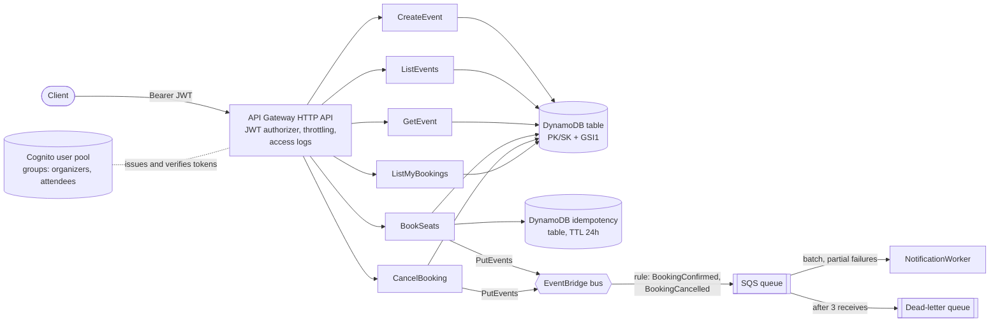

# Bookings API

A serverless event-booking API on AWS. Organizers publish events with a fixed number of seats. Attendees book and cancel seats. Every booking and cancellation emits an event that a worker picks up to send a notification.

Built by Ramiz Raja as a small but complete example of production-style serverless TypeScript:

- API Gateway HTTP API, Lambda (Node.js 24, arm64), DynamoDB single-table design, Cognito, EventBridge and SQS, all defined in CDK.
- Seats can't be oversold: one DynamoDB transaction with conditions, proved by a concurrency test against DynamoDB Local.
- Idempotent bookings through the `Idempotency-Key` header (Powertools for AWS Lambda).
- Hexagonal layers with constructor injection, zod at the boundary, typed errors mapped to RFC 9457 problem responses.
- Least-privilege IAM, cdk-nag AwsSolutions checks on every synth, and tests at three levels with a coverage gate in CI.

The API contract is in [openapi.yaml](openapi.yaml).

## Architecture



All seven functions use Powertools Logger (structured JSON), Tracer (X-Ray) and Metrics (CloudWatch EMF).

### Code layout

```
src/
  shared/           actor and roles, typed errors, HTTP edge (problem details, request parsing),
                    DynamoDB client, keys and cursors, observability
  features/
    events/         domain/ application/ adapters/ http/
    bookings/       domain/ application/ adapters/ http/
    notifications/  domain/ application/ adapters/
  functions/        one thin Lambda entry per route, plus composition.ts (the composition root)
infra/
  bin/app.ts        CDK app; registers cdk-nag AwsSolutions
  lib/              BookingsStack and constructs: Data, Auth, Messaging, Api, AppFunction
tests/
  unit/             use cases and handlers against in-memory fakes
  integration/      DynamoDB adapters and Powertools idempotency against DynamoDB Local
  infra/            CDK template assertions, a snapshot and a cdk-nag check
```

Dependencies point inwards: `domain` has no AWS imports. `application` (use cases) depends on ports such as `EventRepository`, `BookingRepository`, `BookingEventPublisher`, `Clock` and `Telemetry`. `adapters` implement those ports with the AWS SDK. `http` parses and maps. Each file in `functions/` builds its graph once per cold start and exports `handler`.

## Request flow: booking seats

`POST /events/{eventId}/bookings` with `Idempotency-Key: <uuid>` and `{ "seats": 2 }`:

1. API Gateway checks the Cognito access token (signature, issuer, audience, expiry). An invalid token gets a 401 and never reaches Lambda.
2. The handler reads the caller from the verified claims (`sub`, `cognito:groups`). Then it validates the path, the header and the body with zod. Bad input gets a 400 with field errors.
3. Powertools idempotency looks up `[userId, idempotencyKey]` in the idempotency table:
   - A completed record returns the stored booking (201), without booking again.
   - A record that is still in progress gets a 409 `REQUEST_IN_PROGRESS`.
   - The same key sent with a different body gets a 422 `IDEMPOTENCY_KEY_REUSED`.
4. `BookSeats` checks the role (`attendees`), loads the event and applies the domain rules: 1 to 10 seats, the event hasn't started, enough seats left. That last check is only a fast path for a clear error message.
5. The repository writes one `TransactWriteItems` with three parts:
   - Decrement `seatsRemaining` on the event, conditioned on `seatsRemaining >= :seats`.
   - Put the booking, conditioned on `attribute_not_exists`.
   - Put an attendee marker (`EVENT#id / ATTENDEE#userId`), conditioned on `attribute_not_exists`. This allows one active booking per user per event.

   A failed condition maps to `SOLD_OUT`, `ALREADY_BOOKED` or `EVENT_NOT_FOUND`. A `TransactionConflict` is retried with jittered backoff, then surfaced as 409 `CONCURRENT_UPDATE`.

6. A `BookingConfirmed` event goes to EventBridge. A rule sends it to SQS. The worker processes batches and reports only the failed messages back (`ReportBatchItemFailures`). After 3 receives, a message moves to the DLQ.
7. The response is 201 with the booking. Powertools stores it under the key for 24 hours.

Cancelling runs the reverse transaction: it returns the seats, marks the booking `CANCELLED` and deletes the attendee marker. Someone else's booking returns 404, so the API doesn't reveal which booking IDs exist.

## Decisions

| Decision                                   | Why                                                                                                                                                                                                    | Reference                                                                                                                                                                                                                                     |
| ------------------------------------------ | ------------------------------------------------------------------------------------------------------------------------------------------------------------------------------------------------------ | --------------------------------------------------------------------------------------------------------------------------------------------------------------------------------------------------------------------------------------------- |
| HTTP API, not REST API                     | Cheaper and faster. It has a built-in JWT authorizer for Cognito, and this API needs nothing that only REST APIs offer.                                                                                | [Choose between REST and HTTP APIs](https://docs.aws.amazon.com/apigateway/latest/developerguide/http-api-vs-rest.html), [JWT authorizers](https://docs.aws.amazon.com/apigateway/latest/developerguide/http-api-jwt-authorizer.html)         |
| Roles from Cognito groups                  | The groups come through as a verified token claim, so the functions need no extra lookup. Self sign-up is off and an admin assigns groups.                                                             | [Cognito user pool groups](https://docs.aws.amazon.com/cognito/latest/developerguide/cognito-user-pools-user-groups.html)                                                                                                                     |
| Single DynamoDB table with GSI1            | All access patterns are known, so one table keeps the event, its bookings and its attendee markers in one partition. That partition can then be written atomically. See `src/shared/dynamodb/keys.ts`. | [Single-table design](https://docs.aws.amazon.com/amazondynamodb/latest/developerguide/data-modeling-foundations.html)                                                                                                                        |
| Conditional transaction for seats          | The condition in DynamoDB is the only thing that prevents overselling. Checking in code first would race.                                                                                              | [TransactWriteItems](https://docs.aws.amazon.com/amazondynamodb/latest/developerguide/transaction-apis.html), [Condition expressions](https://docs.aws.amazon.com/amazondynamodb/latest/developerguide/Expressions.ConditionExpressions.html) |
| Powertools idempotency, scoped per user    | Retries after a timeout are safe. Putting the user in the key means two users can't collide. Failed calls aren't stored, so a retry after `SOLD_OUT` runs again.                                       | [Powertools idempotency](https://docs.aws.amazon.com/powertools/typescript/latest/features/idempotency/)                                                                                                                                      |
| EventBridge → SQS → Lambda with a DLQ      | The bus decouples producers from consumers. The queue adds buffering, retries and a DLQ. The queue's visibility timeout is 6x the worker timeout, as AWS recommends.                                   | [SQS as a Lambda event source](https://docs.aws.amazon.com/lambda/latest/dg/with-sqs.html), [Partial batch responses](https://docs.aws.amazon.com/lambda/latest/dg/services-sqs-errorhandling.html)                                           |
| Powertools Logger, Tracer, Metrics         | Structured logs with correlation IDs, X-Ray traces of AWS SDK calls, and business metrics (`BookingConfirmed`, `SeatsBooked`, `BookingRejectedSoldOut`) without custom plumbing.                       | [Powertools for AWS Lambda (TypeScript)](https://docs.aws.amazon.com/powertools/typescript/latest/)                                                                                                                                           |
| `NodejsFunction`, Node.js 24 on arm64, ESM | esbuild bundles a small ESM file per function. Graviton costs less per GB-second.                                                                                                                      | [NodejsFunction](https://docs.aws.amazon.com/cdk/api/v2/docs/aws-cdk-lib.aws_lambda_nodejs-readme.html), [arm64 architecture](https://docs.aws.amazon.com/lambda/latest/dg/foundation-arch.html)                                              |
| One IAM role per function, least privilege | Each function gets only the DynamoDB actions its code calls, on its own tables, and writes only to its own log group.                                                                                  | [Lambda execution role](https://docs.aws.amazon.com/lambda/latest/dg/lambda-intro-execution-role.html)                                                                                                                                        |
| cdk-nag AwsSolutions on every synth        | Findings fail `cdk synth`. Each accepted finding is acknowledged with a reason in `infra/lib/nag-suppressions.ts`.                                                                                     | [cdk-nag](https://github.com/cdklabs/cdk-nag)                                                                                                                                                                                                 |
| zod at the edge, typed errors inside       | Handlers turn untrusted input into typed commands. Domain code throws `AppError` subclasses, and only the HTTP edge maps them to status codes. Anything else becomes a generic 500.                    | [RFC 9457 problem details](https://www.rfc-editor.org/rfc/rfc9457)                                                                                                                                                                            |

## Run and test

Requirements: Node.js 24 (see `.nvmrc`) and Docker for the integration tests.

```sh
npm ci
npm run format:check   # Prettier
npm run lint           # typescript-eslint strict-type-checked
npm run typecheck      # tsc, strict
npm run test:unit
npm run test:integration   # starts amazon/dynamodb-local with Testcontainers and stops it afterwards
npm run test:infra
npm run test:coverage      # all three projects, fails below 90% lines/functions/statements, 85% branches
npm run synth              # bundles every function and runs cdk-nag
```

If you use Colima instead of Docker Desktop, point Testcontainers at its socket first:

```sh
export DOCKER_HOST=unix://$HOME/.colima/default/docker.sock
export TESTCONTAINERS_DOCKER_SOCKET_OVERRIDE=/var/run/docker.sock
```

The concurrency test (`tests/integration/concurrency.test.ts`) sends 30 bookings at once for an event with 5 seats. It asserts that exactly 5 succeed, the seat count ends at 0, and every other request gets `SOLD_OUT` or `CONCURRENT_UPDATE`.

CI (`.github/workflows/ci.yml`) runs the same steps on every push and pull request.

## Deploy

This repository has not been deployed. To deploy it to your own account:

```sh
npx cdk bootstrap aws://<account>/<region>   # once per account and region
npx cdk deploy BookingsApi
```

The stack outputs the API URL, the user pool ID, the app client ID and the DLQ URL. Create users in the pool and add them to the `organizers` or `attendees` group. An app client using the SRP flow (for example Amplify) can then get an access token.

The defaults are for a demo: on-demand billing, `RemovalPolicy.DESTROY` on tables, queues and log groups, 7-day log retention, and stage throttling at 50 requests per second (burst 100). For real data, pass `removalPolicy: RemovalPolicy.RETAIN` to `BookingsStack`. `npx cdk destroy BookingsApi` removes everything.

## Trade-offs and next steps

- **Dual write.** The booking is committed first and the event is published afterwards. If `PutEvents` fails, the booking still stands, an `EventPublishFailed` metric is recorded and no notification is sent. An outbox would close this gap: write the event into the same transaction, then let DynamoDB Streams and an EventBridge Pipe publish it. I left it out to keep the example small.
- **Separate idempotency table.** Powertools could share the main table, but a separate table keeps TTL and access patterns apart and makes IAM simpler.
- **Hot partition.** All bookings for one event write to the same item. That is what makes the transaction safe, but a very popular event is limited by the throughput of a single item. Real ticketing at that scale would add a queue or seat sharding in front.
- **Listing events.** Upcoming events share one GSI partition (`EVENTS`). That is fine at this size. A busy catalog would shard by month or venue.
- **Cognito MFA and the Plus feature plan are off** (acknowledged in cdk-nag). Both are a sensible default in production, but they add cost and setup a demo doesn't need.
- **Notifications are a stub.** The worker logs the message. A real adapter (SES, SNS, a push provider) would implement the same `Notifier` port.
- **No WAF or custom domain**, both of which a public production API would have.
